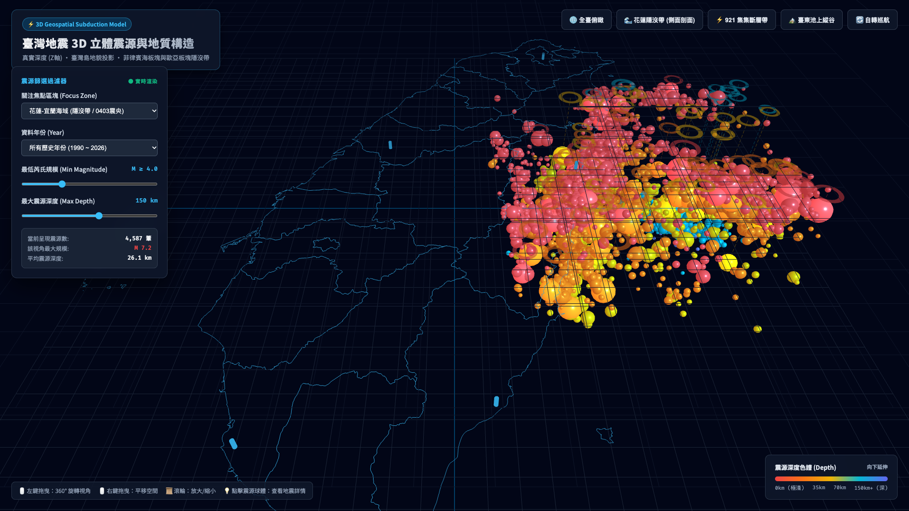
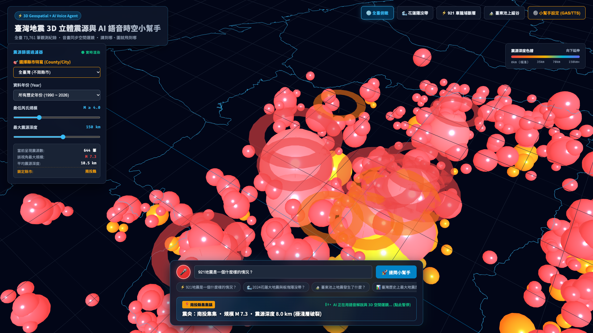
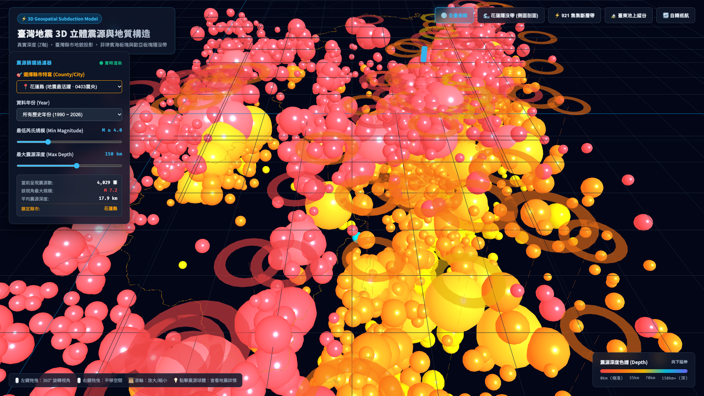
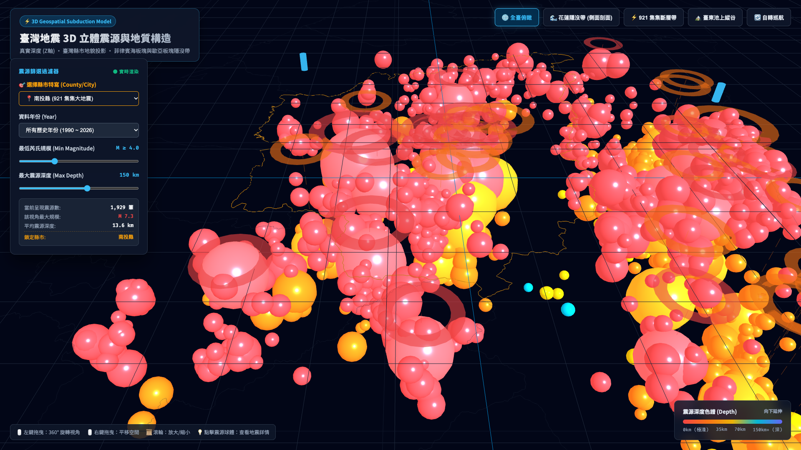

# 🇹🇼 台灣 3D 地震空間視覺化與語音導覽小幫手
### Taiwan Earthquake 3D Spatial Visualizer & Voice-Spatial AI Assistant

[](https://nutcelvischen-jpg.github.io/taiwan-earthquake-3d/)
[](https://threejs.org/)
[](https://developers.google.com/apps-script)
[](https://openrouter.ai/)
[](https://opendata.cwa.gov.tw/)

專為台灣地震歷史資料打造的 **3D WebGL 沉浸式空間視覺化系統** 與 **語音即時連動 AI 導覽小幫手**。整合交通部中央氣象署（CWA）1990 年至 2026 年共 **73,761 筆全量地震紀錄**，並首創「**語音回答即時連動 3D 鏡頭飛行（Spatial Voice-Camera Beat Sync）**」技術——當使用者用聲音詢問歷史地震時，AI 一邊用逼真語音回答，鏡頭一邊自動平滑飛掠震央與斷層帶，並同步切換講述字幕！

---

## 🌟 線上即刻體驗 (Live Demo)

- 🚀 **主視覺化與 AI 語音助理**：[開啟 3D 地震小幫手](https://nutcelvischen-jpg.github.io/taiwan-earthquake-3d/)
- 📖 **氣象署開放資料 API 下載互動教學**：[開啟教學模擬器](https://nutcelvischen-jpg.github.io/taiwan-earthquake-3d/cwa_earthquake_tutorial_simulator.html)
- ⚙️ **Google Apps Script 後端部署指南**：[開啟圖文指引](https://nutcelvischen-jpg.github.io/taiwan-earthquake-3d/google_apps_script_guide.html)
- 🎬 **60 秒氣象署 API 下載影片**：[檢視影片 (MP4)](./videos/CWA氣象署地震資料API下載教學_60s.mp4)

---

## 📸 視覺效果預覽 (Previews)

| 3D 板塊隱沒帶立體視覺化 | AI 語音問答與 3D 鏡頭聯動 (以 921 為例) |
| :---: | :---: |
|  |  |

| 花蓮外海立體深層隱沒帶聚焦 | 南投車籠埔斷層垂直剖面檢視 |
| :---: | :---: |
|  |  |

---

## ✨ 核心亮點功能

### 1. 3D WebGL 震源深度與隱沒帶剖面
- **立體座標轉換**：以台灣地理中心（東經 121.0°, 北緯 23.7°）為原點，經緯度與深度採用 1:1 等比例真實物理投影，精準重現**菲律賓海板塊向歐亞板塊隱沒之「班尼奧夫帶（Wadati-Benioff Zone）」**。
- **深度漸層色帶**：
  - 🔴 **極淺層 (< 15 km)**：車籠埔斷層破裂帶、各活斷層。
  - 🟠 **淺層 (15–35 km)**：中央山脈與西部麓山帶。
  - 🟢 **中深層 (35–70 km)**：花東縱谷向東傾斜之隱沒前緣。
  - 🔵 **深層 (> 70 km)**：宜蘭外海、琉球海溝下方隱沒板塊深部。
- **垂直投影落柱（Drop Lines）**：直觀感受震源在地底幾十公里處的立體分佈。

### 2. 全台 20 縣市空間邊界與一鍵聚焦
- 內建台灣本島與離島各縣市空間拓撲邊界，點擊縣市下拉選單或按鈕，自動產生**金黃色高亮發光邊界**，視角平滑運鏡至該縣市中心。

### 3. AI 語音小幫手：聲音問答 + 3D 空間聯動 (Spatial Storytelling)
- **語音輸入（Web Speech API）**：直接按住麥克風用說的，例如：「*請告訴我 921 地震是一個什麼樣的情況？*」
- **雙向聲音解說（TTS）**：採用瀏覽器高音質繁體中文語音或 OpenRouter Gemini 3.8 Flash TTS。
- **即時分鏡劇本聯動（Beat Sync）**：
  - AI 回答時會同時切分「講述節奏（Story Beats）」與「空間相機座標（Camera Keyframes）」。
  - 說到「**南投集集鎮**」時，相機自動俯衝至集集車籠埔斷層上方並標註震央；
  - 說到「**車籠埔斷層由南向北破裂**」時，鏡頭沿著斷層線向北拉伸；
  - 說到「**台北盆地共振災情**」時，鏡頭立刻推至大台北盆地並呈現震度資訊；
  - 說到「**全島餘震分佈**」時，鏡頭拉出全台高空 3D 俯視全貌。

### 4. 20 縣市歷史最大地震專屬語音導覽與地質影響卡片 (NEW!)
- **一鍵深度解說**：當使用者在下拉選單切換至任一縣市（如花蓮縣、南投縣、臺南市、苗栗縣等），系統自動呈現該縣市**歷史最強地震規模、發生年代與地質斷層災情摘要**。
- **3D 飛掠與語音導覽**：點擊「🔊 聆聽 AI 語音解說此縣市歷史最大地震」，AI 語音助理立即啟動，平滑將 3D 鏡頭推向該縣市震央、斷層破裂帶與受災區域，進行生動的立體解說。
- **自動播放導航開關**：勾選「切換縣市時自動播放語音導覽」，每次切換縣市即可享受全自動的沈浸式台灣地震地質聲音之旅！

### 5. 零伺服器成本的安全 Google Apps Script 後端
- 採用 Google Apps Script（GAS）Web App 作為安全中繼後端。
- OpenRouter API Key 儲存在 Google 伺服器端的 `Script Properties` 中，**前端完全不暴露任何敏感金鑰**。
- 內建台灣 73,761 筆地震 RAG 知識庫，即使無 API Key 亦內建本機降級解答引擎，保證永遠可用！

---

## 🏗️ 系統架構圖 (Architecture)

```mermaid
flowchart TD
    subgraph Client["前端 (GitHub Pages / 靜態 Web)"]
        UI["使用者介面 (Three.js 3D Canvas + 控制面板)"]
        ASR["Web Speech API 語音辨識 (聽)"]
        TTS["Web Speech TTS / OpenRouter 語音合成 (說)"]
        Engine["3D 運鏡飛行控制器 (TWEEN 鏡頭插值)"]
        Subtitles["即時分鏡字幕 & 地點標籤橫幅"]
    end

    subgraph Backend["無伺服器後端 (Google Apps Script)"]
        GAS["GAS Web App (doGet / doPost)"]
        RAG["台灣地震知識庫 (73,761 筆歷史數據索引)"]
        Prop["Script Properties (安全儲存 OPENROUTER_API_KEY)"]
    end

    subgraph AI["大語言模型 (OpenRouter)"]
        LLM["Google Gemini 3.8 Flash"]
    end

    ASR -->|語音轉文字 "921地震是什麼情況？"| UI
    UI -->|JSONP / GET 帶問句| GAS
    GAS -->|注入地震 RAG 知識 + Prompt| LLM
    Prop -.->|驗證金鑰| LLM
    LLM -->|輸出結構化故事分鏡與經緯度座標| GAS
    GAS -->|回傳 Beats JSON| UI
    UI -->|驅動 TTS 播放音訊| TTS
    UI -->|依時間軸即時更新| Subtitles
    UI -->|平滑插值運鏡飛行至指定經緯度| Engine
```

---

## 📂 檔案目錄結構 (Project Structure)

```text
taiwan-earthquake-3d/
├── index.html                           # 主入口網頁 (GitHub Pages 首頁)
├── taiwan_earthquake_3d.html            # 3D 地震小幫手完整獨立版
├── cwa_earthquake_tutorial_simulator.html # CWA 氣象署開放資料下載互動模擬器
├── google_apps_script_guide.html        # Google Apps Script 部署圖文教學
├── README.md                            # 專案說明文件
├── .gitignore                           # Git 忽略設定
├── earthquake_data/                     # 地震資料核心資產
│   ├── earthquake_3d_data.js            # 19,372 筆重點地震三維數據 (零 CORS 載入)
│   ├── earthquakes_3d_points.json       # 結構化三維地震點陣列
│   ├── taiwan_boundary_3d.json          # 全台 20 縣市 3D 向量邊界
│   ├── county_centers.json              # 各縣市中心經緯度與三維視角參數
│   ├── earthquake_yearly_summary.json   # 1990-2026 各年度地震體量統計
│   ├── taiwan_earthquakes_1990_2026.csv # 73,761 筆完整歷史地震 CSV
│   └── preview_*.png                    # 各功能視覺預覽截圖
├── google_apps_script/                  # 後端程式碼
│   ├── Code.js                          # GAS 完整後端邏輯 (RAG + OpenRouter 呼叫)
│   └── README.md                        # GAS 部署步驟指引
├── scripts/                             # 自動化生成與處理腳本
│   ├── process_all_earthquakes.py       # CWA 全量 XML 解析與座標轉換
│   ├── generate_cwa_tutorial_audio.py   # OpenRouter Gemini 3.8 Flash TTS 配音生成
│   └── record_cwa_tutorial.js           # 1080p 60FPS 無頭 Chrome 螢幕錄影腳本
└── videos/
    └── CWA氣象署地震資料API下載教學_60s.mp4 # 60 秒氣象署 API 下載精美教學影片
```

---

## 🚀 本地開發與執行 (Local Development)

由於本專案完全基於純靜態前端技術（Zero Dependencies），您不需要安裝複雜的 Node.js 或前端建構工具，直接啟動本機 HTTP 伺服器即可瀏覽：

```bash
# 複製專案
git clone https://github.com/nutcelvischen-jpg/taiwan-earthquake-3d.git
cd taiwan-earthquake-3d

# 使用 Python 啟動輕量伺服器
python3 -m http.server 8000
```

開啟瀏覽器造訪 `http://localhost:8000/` 即可立即進入 3D 地震空間！

---

## 🛠️ Google Apps Script (GAS) 後端部署說明

若您想使用自己的 Google 帳號與 OpenRouter Key 部署專屬的地震小幫手後端：

1. 開啟 [Google Apps Script 官方首頁](https://script.google.com/) 並點擊「**新增專案**」。
2. 將本專案中的 `google_apps_script/Code.js` 程式碼完整複製並覆蓋編輯器內容。
3. 點選左側齒輪圖示「**專案設定**」，在最下方的「**指令碼屬性 (Script Properties)**」中新增：
   - **屬性 (Property)**：`OPENROUTER_API_KEY`
   - **值 (Value)**：貼上您的 OpenRouter 金鑰（`sk-or-v1-...`）
4. 點選右上角「**部署**」➔「**新增部署**」：
   - 種類選「**網路應用程式 (Web App)**」
   - 執行身分：**我 (您的 Google 帳號)**
   - 誰可以存取：**所有人 (Anyone)**
5. 複製生成的 **Web App 網址**（格式為 `https://script.google.com/macros/s/AKfy.../exec`）。
6. 回到 `index.html` 網頁右上方點擊「⚙️ 設定」，貼上您的 GAS 網址即可！

---

## 📊 資料來源與致謝 (Data Attribution)

- **地震歷史資料來源**：[交通部中央氣象署開放資料平臺 (CWA OpenData)](https://opendata.cwa.gov.tw/)
  - `E-A0073-002`：1990 年至 2025 年顯著有感與小區域地震完整目錄 (73,729 筆)
  - `E-A0015-001` & `E-A0016-001`：2026 即時有感地震報告 (32 筆)
- **3D 引擎**：[Three.js](https://threejs.org/)
- **AI 語言與語音模型**：Google Gemini 3.8 Flash via [OpenRouter](https://openrouter.ai/)

---

## 📄 授權條款 (License)

本專案採用 [MIT License](LICENSE) 授權，歡迎學術研究、防災教育與社群自由改進使用。
